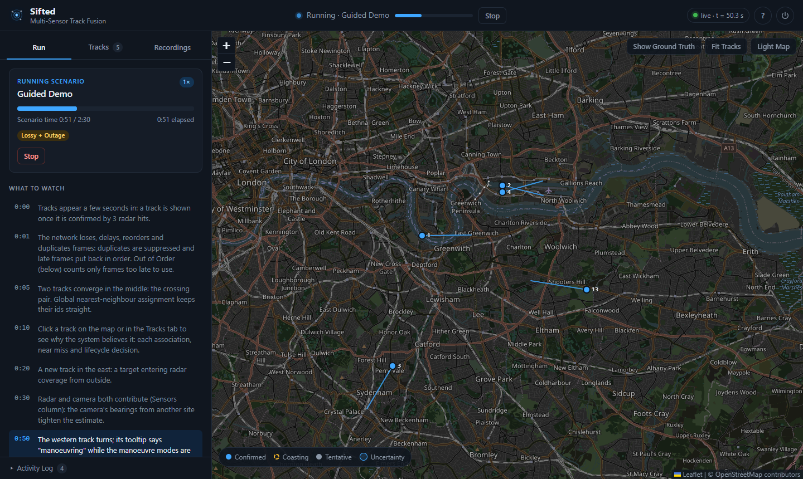
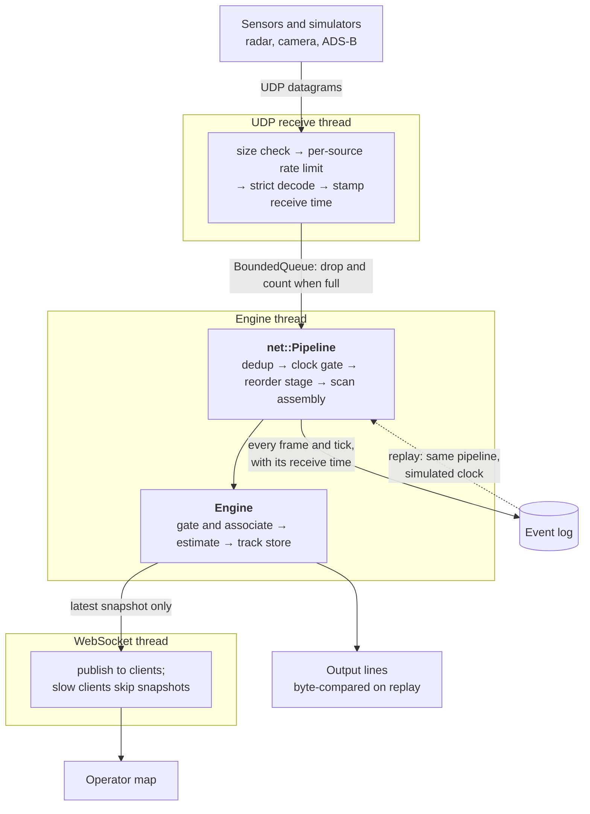
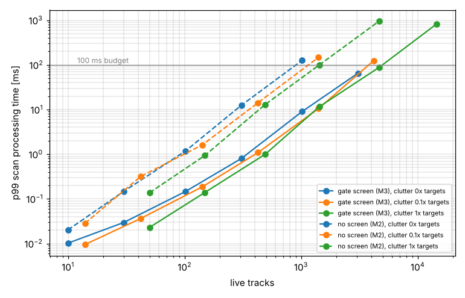

<p align="center">
  
</p>

<h1 align="center">Sifted</h1>

<p align="center">Deterministic multi-sensor, multi-target track fusion in C++20.</p>

Sifted estimates the position and velocity of multiple targets from noisy,
partial and out-of-order measurements. Radar (range-bearing), camera
(bearing-only) and ADS-B (geodetic) measurements arrive over UDP. A
single-threaded engine associates them to tracks and filters them, and snapshots
are published over WebSocket to a live map. Every input is recorded with its
receive time, so any run, including one with packet loss or sensor faults, can be
replayed and compared byte for byte with the original output.

Tracking is hard here because the inputs disagree: sensors measure different
things (range and bearing, bearing only, latitude and longitude), arrive late,
duplicated or not at all, and targets fly close together and manoeuvre. The
system has to decide every scan which measurement belongs to which aircraft,
and be able to show afterwards exactly why.

## Highlights

Accuracy results are from seeded simulations scored against ground truth.
Real aircraft data is evaluated separately, and the tracker does worse there.

- **Accuracy:** position RMSE 9.35 m against 22.2 m for unfiltered radar on
  straight flight. Over 500 simulated multi-target runs, mean RMSE 10.02 m,
  and 9.2% of runs lose a target's identity at least once.
- **Determinism:** a recorded live run, including packet loss, duplicates and a
  sensor restart, replays bit for bit (2,056 output lines identical under `cmp`).
- **Degraded networks:** a bounded reorder window cuts out-of-order drops from
  29.0% to 0.1% at the severe impairment level.
- **Untrusted input:** 7 fuzz targets cover every C++ parser of external input,
  and ThreadSanitizer runs over the whole test suite.
- **Known weaknesses:** on real OpenSky ADS-B data the tracker predicts worse
  than dead reckoning, and from 5 clutter points per scan up the default IMM
  confirms more false tracks than a Stone Soup baseline. Both are measured and
  reported below.

Every figure links to its test or report in
[Engineering evidence](#engineering-evidence). The installers, desktop launcher
and operator map are there so the system can be run and inspected, not as
claims in themselves; see [Quick start](#quick-start).
[How this was built](#how-this-was-built) describes the role of AI assistance.

<p align="center">
  
</p>

## Architecture



The engine thread is the only thread that touches tracker state. The other two
hand data over at two points: the bounded queue, and a snapshot pointer swapped
under a mutex. The [thread ownership table](docs/design.md#2-architecture-and-threading)
lists what each thread owns and shares.

The code is split into two libraries so that the determinism rules follow the
link graph:

- **`sifted_core`** has no threads, sockets or wall clock. It holds the wire
  codec, estimation, association, track store, event log and the pure ingest
  pipeline. Time is an input, so the same ordered input gives the same output.
- **`sifted_net`** is the OS-facing edge: UDP, WebSocket, rate limiter and system
  clock. Only the daemon, the tests and the WebSocket fuzz target link it.

The full rules are in the [determinism contract](docs/design.md#3-determinism-contract).

## Engineering evidence

Accuracy figures in this table come from seeded simulator scenarios scored
against ground truth, where sensor noise matches the filter's assumptions
exactly. One command regenerates the [evaluation scorecard](docs/evaluation.md)
(one noise realisation per fixture); another the
[Monte Carlo evaluation](docs/evaluation-monte-carlo.md) (hundreds of
independent realisations, with intervals), and a third the
[comparison with a Stone Soup baseline](docs/evaluation-baseline.md).
Measurements on recorded aircraft are kept apart, in
[Real-data evaluation](#real-data-evaluation-recorded-ads-b) below.

| Claim | Measured | Proof |
|---|---|---|
| **Estimation.** Interacting Multiple Model estimator: three constant-velocity modes (quiet, manoeuvre, hard), mode switching by a continuous-time Markov chain, mode-matched range-bearing and bearing-only EKF updates in Joseph form. The legacy single filter remains selectable | Position RMSE against unfiltered radar: 9.35 m vs 22.2 m on straight flight (0.42; legacy 11.1 m), 10.1 m vs 14.9 m in a 3 deg/s turn (0.68; legacy 10.6 m) | [`scenario_regression_test.cpp`](tests/scenario_regression_test.cpp), [`imm_test.cpp`](tests/imm_test.cpp), [ADR 0014](docs/adr/0014-imm-motion-model.md), [design §6-7](docs/design.md#6-estimation-and-association) |
| **Manoeuvring targets.** 1 radar at 1 Hz, turns from 0.3 g to 7 g at 100 and 250 m/s, 10 noise seeds each, on seeds and profiles disjoint from the ones the parameters were checked on | ID switches per run from 1 g to 5 g: legacy 2.0-6.8, IMM 0.0-0.9; missed target-instants 4.5-13.6% → 0.0-2.9% | [Motion-model evaluation](docs/motion-model-evaluation.md), [ADR 0014](docs/adr/0014-imm-motion-model.md) |
| **Filter consistency.** The covariance matches the actual error when the model is right | Legacy filter, 200-run Monte Carlo with matched model: NEES 4.02 at t = 90 s (95% interval 3.62-4.40, 4 dof), NIS 2.001 over 16,184 updates (1.969-2.031). IMM on its own switching model, 1,000 runs: NEES 4.15-4.22, NIS 2.002 (moment matching is 4-5% optimistic). In turns NEES falls from 32 (legacy) to 2.7 | `ConsistencyMonteCarlo.*` in [`consistency_test.cpp`](tests/consistency_test.cpp), [design §7](docs/design.md#filter-consistency) |
| **Tracking accuracy, one realisation.** All seven fixtures, direct engine feed, the single committed noise draw of each (a regression check, not a statistical claim) | Mean RMSE 8.55 m, worst target 10.98 m; 0 missed target-instants, 0 ID switches, 0 false tracks | [Scorecard summary](docs/evaluation.md#summary-over-all-scenarios) |
| **Tracking accuracy, Monte Carlo.** The five multi-target scenarios, 100 independent noise realisations each (500 runs), direct feed; mean over runs [95% bootstrap interval] | Mean RMSE 10.02 m [9.44, 10.66]; worst target RMSE 9.10 m median, **60.13 m worst run**. ID switches 0.21 per run [0.15, 0.27]: **9.2% of runs [7.0, 12.1] break identity at least once**, almost all in `formation_split` (46% of its runs, 1.06 switches per run). False tracks 0.01 per run; GOSPA (c = 100 m, p = 2) 17.1 m | [Monte Carlo evaluation](docs/evaluation-monte-carlo.md), [ADR 0015](docs/adr/0015-monte-carlo-evaluation-and-baseline.md) |
| **Clutter and detection.** Same scenarios, every radar at 0.5-100 clutter points per scan and Pd 0.9 or 0.7, 100 runs per condition | **False tracks grow steeply with clutter**: 0.85 per run at 5 points per scan, 26 at 20, 152 at 50 and 443 at 100 (Pd 0.9), while accuracy on true targets holds (mean RMSE 9.3-11.7 m) and the track cap is never reached. Pd 0.7 raises missed target-instants (0.19% → 0.68% at 0.5 points per scan, 0.05% → 1.01% at 20) and ID switches | [Monte Carlo summary](docs/evaluation-monte-carlo.md#summary-per-condition-all-scenarios-pooled) |
| **External baseline.** A Stone Soup 1.9.1 tracker (EKF, constant velocity, the same noise, gate, GNN and lifecycle rules), on the same runs and inputs and scored by the same scorer; neither tracker tuned | Like-for-like (Sifted constant velocity, fixed q), 100 paired runs: no detectable difference on any of RMSE, missed, ID switches, false tracks or GOSPA (11.34 m vs 11.86 m mean RMSE), which supports the configuration mapping. Sifted's default IMM is better on RMSE (−1.17 m [−2.09, −0.28]), ID switches and GOSPA. **Stone Soup wins under clutter**: from 5 points per scan up, the IMM confirms more false tracks (26.1 vs 14.2 per run at 20) and its GOSPA is 87 m [83, 92] worse there. Sifted's constant-velocity configurations have fewer false tracks than Stone Soup | [Baseline comparison](docs/evaluation-baseline.md), [configuration mapping](benchmarks/baselines/stonesoup/README.md) |
| **Association.** Chi-square gating (p = 0.999) and Hungarian global nearest neighbour. `formation_split` flies three targets 45 m apart (about 3 radar range sigmas), so assignment decides identity on every scan | With the legacy constant-velocity filter, which this comparison is kept on: GNN 0 ID switches, worst target 11.58 m; greedy 2 ID switches, worst target 35.49 m. Over five noise seeds: 12 ID switches for GNN, 28 for greedy. The IMM loses this formation's identity more often (ADR 0014) | `MultiTargetRegression.FormationSplit` in [`multi_target_regression_test.cpp`](tests/multi_target_regression_test.cpp), [ADR 0004](docs/adr/0004-association-and-lifecycle.md) |
| **Determinism.** Replay reproduces the output bit for bit, including impaired and faulted runs | Live daemon run through the impairment proxy with a sensor restart: 2,056 output lines identical under `cmp`, with 117 frames lost to the outage, 89 to loss and 28 duplicated | `Replay.RecordedRunReplaysBitForBit`, `Reorder.ImpairedRecordedRunReplaysBitForBit`, `Faults.FaultedRunsAreDeterministic`; [design §3](docs/design.md#3-determinism-contract) |
| **Degraded networks.** No reorder window against a 0.5 s window, at the severe level (8% loss plus bursts, delay 100 ms + U(0, 800 ms), 5% duplicates; 9 runs) | Out-of-order drops 29.0% → 0.1%, missed target-instants 6.79% → 0.53%, ID switches 7 → 1. Cost on a clean network: +0.27 m mean RMSE (IMM; the legacy filter's figures when the window was chosen: 6.52% → 0.52%, 6 → 1, +0.35 m) | [Design §9](docs/design.md#9-degraded-network-behaviour), [ADR 0009](docs/adr/0009-out-of-order-policy.md) |
| **Outage recovery.** Every link down, mild impairment, 21 runs per row | 5 s outage: recovered in 1.3 s mean, 3.0 s worst. 15 s outage: 3.6 s mean, 4.0 s worst, with tracks re-initiated (54 ID switches in total) | [Scorecard summary](docs/evaluation.md#summary-over-all-scenarios), `DegradedNetwork.RecoveryAfterOutage` |
| **Untrusted input.** Every C++ parser of external input is fuzzed with ASan and UBSan | 7 libFuzzer targets, each run for 60 s in CI. `fuzz_engine` also checks that results match an engine without the gate screen | [`fuzz/`](fuzz/README.md), [threat model](docs/threat-model.md), [CI](.github/workflows/ci.yml) |
| **Concurrency.** ThreadSanitizer runs over the whole test suite | Includes live UDP flood tests with a concurrent consumer. A burst of 5,000 malformed datagrams enqueues 0 frames | `UdpFlood.*` in [`udp_flood_test.cpp`](tests/udp_flood_test.cpp), [design §2](docs/design.md#2-architecture-and-threading), [threat model](docs/threat-model.md#sensor-and-input-faults) |
| **Gate screen.** A conservative bound skips pairs that cannot gate, with no change in results | 1,000 targets, 10% clutter: median scan 145 ms → 10.0 ms; instructions 8.55 G → 1.14 G (callgrind on a RelWithDebInfo build, 3 scans) | `GateScreen.NeverChangesResults` in [`gate_screen_test.cpp`](tests/gate_screen_test.cpp), [proof in design §10](docs/design.md#10-performance), [benchmarks](docs/benchmarks.md#profiling-and-the-one-optimisation) |
| **Capacity.** One engine thread on a 2 vCPU VM, one scan per second (1 Hz), 10% clutter, p99 scan time ≤ 100 ms Engine only (`Engine::on_scan`, no networking). Legacy filter: 2,976 targets (about 4,150 live tracks). The p99 is noisy at this edge: 3,000 targets measured 125 ms in another sweep. The IMM against the legacy filter on one machine: 2,898 against 2,976 tracks per core (97%); throughput 213,000 against 327,000 measurements/s. The daemon's defaults are lower: at most 1,024 tracks (`--max-tracks`) and 256 measurements per scan | [Benchmarks: tracks per core](docs/benchmarks.md#tracks-per-core), [motion models](docs/benchmarks.md#motion-models-legacy-cv-against-the-imm-adr-0014), [ADR 0011](docs/adr/0011-benchmark-method.md) |
| **End-to-end latency.** UDP send to WebSocket snapshot through the real daemon on loopback, 100 targets | Median 101 ms with the reorder window off, 502 ms with the default 0.5 s window. Scan assembly and the window dominate, not processing | [Benchmarks: end-to-end latency](docs/benchmarks.md#end-to-end-latency-daemon) |

Performance figures were measured on a 2 vCPU virtualised Intel Xeon with 8 GB
of memory, using GCC 13.3 and the `release` preset, with the legacy filter. The
IMM's relative cost was measured later, against the legacy filter, on an Intel
Core Ultra 7 155H laptop under WSL2 with the same method. Engine timings use a seeded
synthetic workload with 5 runs per configuration (3 without the gate screen). The
end-to-end figures are one run of 30 scans per row. Other work was running on the
second vCPU during part of the runs, and absolute numbers are machine-specific.
The [benchmark report](docs/benchmarks.md) has the method, the raw CSVs and the
commands to reproduce them.

<p align="center">
  
</p>

### Real-data evaluation (recorded ADS-B)

Separate from the simulator figures above: the tracker run on real OpenSky ADS-B
state vectors (five published incident extracts, 16 flights of 5 aircraft after
cleaning, 38,555 reports). The [real-data report](docs/real-data-evaluation.md)
has the provenance, cleaning counts, method and every number below, all from
held-out flights; one command regenerates it from the cached archives.

| Question | Measured on held-out flights | Where |
|---|---|---|
| **Prediction.** Tracker estimate at withheld real reports, against dead reckoning from the last report's own velocity | Median 8.8 m vs 7.2 m at 2-5 s, 36.1 m vs 25.8 m at 20-40 s, 93.5 m vs 69.1 m at 40-80 s: **worse than dead reckoning** at every horizon. Also slightly worse than the legacy filter was (7.5, 35.0, 83.7 m) | [Results A](docs/real-data-evaluation.md#results-a-real-measurements) |
| **ADS-B noise model.** NIS of real updates with the assumed 50 m sigma | 0.11 against 2.00 expected: **inconsistent**, innovations 0.23x the predicted size. A measured 6.8 m sigma (diagnostic) predicts worse beyond 20 s and fragments more (18 vs 0 breaks) | [Findings](docs/real-data-evaluation.md#findings) |
| **Continuity.** One aircraft per run, launcher ADS-B settings | Every report at full rate: 0 fragmentations, 100% coverage. At the live 21.6 s REST cadence (5.4% of reports reach the tracker): 2 fragmentations, 99.6% coverage (legacy filter: 8, 97.5%). With `EngineConfig` defaults: 42 fragmentations | [Consistency and continuity](docs/real-data-evaluation.md#consistency-and-continuity) |
| **Real motion, simulated sensors.** Real flight paths as truth for the simulator's radar and camera | Per-window RMSE median 13.8 m, p95 21.7 m (legacy filter: 15.2 m, 36.6 m), against 11.6 m / 13.4 m on constant-velocity controls; real motion is 42% of the mean squared error; truth interpolation bound (leave-one-out p95) 27.4 m | [Results B](docs/real-data-evaluation.md#results-b-real-trajectories-simulated-sensors) |

Not measured on real data: identity swaps and dense traffic (each extract holds one
aircraft), altitude, and real radar or camera noise. The sample is small and biased
towards unusual flights ([limitations](docs/real-data-evaluation.md#limitations)).

## Design decisions and tradeoffs

- **Single-threaded deterministic engine ([ADR 0002](docs/adr/0002-deterministic-single-threaded-engine.md)).**
  Replay equality becomes a byte comparison and races are confined to the
  handoff points. Throughput per engine is bounded by one core.
- **Global nearest neighbour, not JPDA or MHT ([ADR 0004](docs/adr/0004-association-and-lifecycle.md)).**
  Decisions are deterministic and explainable from a per-track trace. JPDA and
  MHT do better in dense clutter, at much higher complexity.
- **IMM of three constant-velocity modes, not a coordinated-turn model ([ADR 0014](docs/adr/0014-imm-motion-model.md)).**
  The modes share one state, so mixing is exact and bearing-only updates need no
  unobservable turn rate. Gating uses the IMM's own predicted measurement density.
  The costs are more estimation work per track, and less identity margin in
  tight formations. The legacy filter is kept, and old recordings replay with it.
- **Record the engine thread's input ([ADR 0005](docs/adr/0005-event-log.md)).**
  Replay recomputes everything downstream of the log instead of trusting stored
  results. Every parameter that changes output must be in the log header.
- **Bounded reorder window, not retrodiction ([ADR 0009](docs/adr/0009-out-of-order-policy.md)).**
  Tracks keep no state history and association is never revisited. The cost is
  added latency, and data later than the window is dropped and counted.
- **Minimal read-only WebSocket server ([ADR 0006](docs/adr/0006-networking.md)).**
  No networking dependency and a small parser that can be fuzzed. There is no TLS
  or authentication.
- **Opt-in clock gate ([ADR 0010](docs/adr/0010-fault-handling.md)).**
  It stops a sensor with a fast clock from invalidating other sensors' data, but
  it needs senders and receiver on a common timebase, so it is off by default.
- **Timeline guard, honest silence, durable recording ([ADR 0012](docs/adr/0012-live-reliability.md)).**
  One forged timestamp is rejected without a common timebase, the operator is told
  when the picture is stale, and a crash costs a bounded tail of the recording. New
  timelines take a few seconds to confirm.

## Known limitations

- **Sensors are not authenticated.** One forged frame is rejected, but a sustained
  attacker who can reach the UDP port can walk the clock forward in small steps, or
  take over the timeline during an outage until real data returns
  ([ADR 0012](docs/adr/0012-live-reliability.md#residual-risk-no-authentication-see-the-threat-model)).
- **Bit-equality holds only for the same binary and architecture.** Identical
  results across compilers or maths libraries are not promised, because
  transcendental functions such as `sin` and `atan2` can differ
  ([design §3](docs/design.md#3-determinism-contract)).
- **No sensor bias registration.** A 50 m radar range bias shifts the picture by
  about 50 m, and fusing it with an unbiased camera caused 1-6 ID switches
  ([threat model](docs/threat-model.md#sensor-and-input-faults)).
- **The gate screen is still all-pairs.** Cost grows with measurements × tracks.
  A spatial index for more than about 3,000 tracks per thread is deferred
  ([design §10-11](docs/design.md#11-open-questions-final-status)).
- **The covariance is still pessimistic in straight flight.** NEES is about
  half its expected value (IMM 2.1, legacy 2.6, of 4). The simulator's straight
  legs have exactly zero acceleration, and any filter that can follow a
  manoeuvre budgets for one. The IMM fixed turns (NEES 32 → 2.7), not this
  ([design §7](docs/design.md#filter-consistency)).
- **Dense formations lose identity more often with the IMM.** Three targets
  45 m apart: 0.8 ID switches per run against 0.3 for the legacy filter over
  ten noise seeds, worse under mild impairment. A filter agile enough for a 5 g
  turn can also follow a neighbour's detections
  ([ADR 0014](docs/adr/0014-imm-motion-model.md)).
- **On real ADS-B the tracker predicts worse than dead reckoning.** It never sees
  the aircraft's velocity reports, and its 50 m ADS-B sigma is inconsistent with
  real reports (NIS 0.11), yet a measured sigma alone makes prediction worse
  ([real-data findings](docs/real-data-evaluation.md#findings)).
- **Frozen sensors are not detected.** A stuck radar produces stationary false
  tracks until it recovers
  ([threat model](docs/threat-model.md#sensor-and-input-faults)).
- **The macOS install path has not been run on a real Mac**, and the Windows
  installer has been exercised against a simulated WSL
  ([platform status](docs/install.md#system-requirements)).

## Quick start

Clone or download this repository, then run the installer from its folder. The
installer fetches what is missing, builds Sifted and runs an end-to-end smoke
test. Per-platform detail is in the [install guide](docs/install.md).

| Platform | Install | Run |
|---|---|---|
| Linux | `./install.sh` | `./sifted` |
| macOS (with [Homebrew](https://brew.sh)) | `./install.sh` | `./sifted` |
| Windows 10 / 11 (uses WSL) | double-click `install.cmd` | the **Sifted** shortcut, or `sifted.cmd` |

Sifted offers a guided demo when it first opens: five aircraft, one radar and one
camera, with a side panel that explains what to watch. Choose a network condition
or sensor fault for a run, then press **Verify replay** when it ends.

### For engineers

Build and test (Debug, warnings as errors). The other presets are `release`,
`asan`, `tsan` and `fuzz`:

```bash
cmake --preset dev && cmake --build --preset dev && ctest --preset dev
```

Record a live run, replay it and compare the outputs:

```bash
cd sim && python3 -m sifted_sim.generate crossing_pair /tmp/crossing && cd ..
build/dev/src/apps/sifted_fusiond --sensors /tmp/crossing/sensors.cfg \
    --record /tmp/crossing.siftlog --output /tmp/live.txt
```

```bash
# In a second terminal. When it finishes, press Ctrl-C in the first terminal.
cd sim && python3 -m sifted_sim.send crossing_pair --speed 5
```

```bash
build/dev/src/apps/sifted_fusiond --replay /tmp/crossing.siftlog --output /tmp/replay.txt --ws-port 0
cmp /tmp/live.txt /tmp/replay.txt && echo identical
```

Regenerate the ground-truth scorecard:

```bash
cmake --preset release && cmake --build --preset release
build/release/eval/sifted_eval --out docs/evaluation.md
```

Regenerate the real-data report (downloads about 11 MB once, verified by SHA-256):

```bash
cd sim && python3 -m sifted_sim.realeval fetch && python3 -m sifted_sim.realeval run
```

The [development guide](docs/development.md) covers dependencies, fuzzing,
benchmarks, running each component by hand and the launcher's control API.

### Troubleshooting

See [troubleshooting in the install guide](docs/install.md#troubleshooting).

## Repository map

| Path | Contents |
|---|---|
| [`src/sifted/`](src/sifted) | Core and network libraries: wire codec, estimation, association, track store, replay, ingest |
| [`src/apps/`](src/apps) | `sifted_fusiond`, the fusion daemon (live and replay) |
| [`tests/`](tests) | Unit, ground-truth regression, degraded-network, fault-injection and UDP flood tests |
| [`eval/`](eval) | Shared ground-truth scoring library, the `sifted_eval` scorecard tool, the `sifted_realeval` real-data tool and the real-data manifest |
| [`fuzz/`](fuzz) | Seven libFuzzer targets and their seed corpora |
| [`benchmarks/`](benchmarks) | Engine benchmark harness, end-to-end latency script, report generator |
| [`sim/`](sim) | Python sensor simulators, scenarios, fault injection, impairment proxy, OpenSky adapter |
| [`app/`](app) | Python launcher and local control API |
| [`web/`](web) | Operator view: HTML, CSS and JavaScript with Leaflet bundled, no build step |
| [`docs/`](docs) | [Design](docs/design.md), [ADRs](docs/adr/), [threat model](docs/threat-model.md), [benchmarks](docs/benchmarks.md), [scorecard](docs/evaluation.md), [demo runbook](docs/demo.md) |
| [`scripts/`](scripts), [`cmake/`](cmake) | Demo runner and Windows installer scripts; build options, sanitizers and dependencies |

## Scope and ground rules

- Uses only public data and the project's own simulations. Nothing is based on controlled or non-public technical information.
- Focused on perception, tracking, and situational awareness. Nothing in the project involves weapons or targeting.
- Scope is cut before polish. A smaller system that works, is tested, and is clearly documented beats a large one that is half-finished.

## Data sources and third-party software

Live aircraft data comes from the [OpenSky Network](https://opensky-network.org/);
its use is subject to the OpenSky Network's terms of use. The real-data evaluation
uses OpenSky's published incident extracts (CC BY 4.0 per their READMEs, and the
OpenSky terms); they are downloaded, never committed, and cited as M. Schäfer et
al., *Bringing up OpenSky*, IPSN 2014 ([provenance](docs/real-data-evaluation.md#provenance)). Map tiles ©
[OpenStreetMap](https://www.openstreetmap.org/copyright) contributors. The
operator view bundles [Leaflet](https://leafletjs.com/) 1.9.4 (BSD 2-Clause,
`web/vendor/leaflet/LICENSE`).

## How this was built

Most of the code, tests and documentation here were written by Claude Code,
Anthropic's coding agent, working under my direction in milestone sessions.
[`CLAUDE.md`](CLAUDE.md) is the guidance file the agent reads. My part:

- setting the scope, the milestone order and the working rules for each
  session (no special-cased fixes; report anything left unverified);
- building and running every preset, sanitizer run and installer on my own
  WSL2 machine, and reporting the failures that were then fixed;
- deciding what to keep, cut and publish, including the real-data result
  where the tracker loses to dead reckoning.

ADRs 0004-0007 were recorded after the code they describe; each says so.

## License

Released under the [MIT License](LICENSE).
