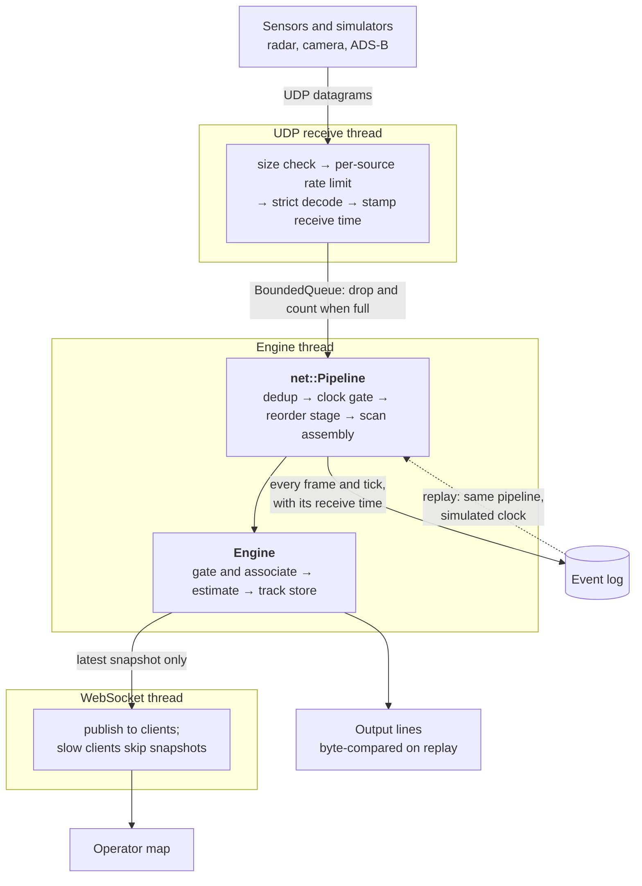

<p align="center">
  
</p>

<h1 align="center">Sifted</h1>

<p align="center">Deterministic multi-sensor, multi-target track fusion in C++20.</p>

Sifted estimates the position and velocity of multiple targets from noisy,
partial and out-of-order measurements. Radar (range-bearing), camera
(bearing-only) and ADS-B (geodetic) measurements arrive over UDP. A
single-threaded engine associates them to tracks and filters them, and snapshots
are published over WebSocket to a live map. Every input is recorded with its
receive time, so any run, including one with packet loss or sensor faults, can be
replayed and compared byte for byte with the original output.

<p align="center">
  
</p>

## Architecture



The engine thread is the only thread that touches tracker state. The other two
hand data over at two points: the bounded queue, and a snapshot pointer swapped
under a mutex. The [thread ownership table](docs/design.md#2-architecture-and-threading)
lists what each thread owns and shares.

The code is split into two libraries so that the determinism rules follow the
link graph:

- **`sifted_core`** has no threads, sockets or wall clock. It holds the wire
  codec, estimation, association, track store, event log and the pure ingest
  pipeline. Time is an input, so the same ordered input gives the same output.
- **`sifted_net`** is the OS-facing edge: UDP, WebSocket, rate limiter and system
  clock. Only the daemon, the tests and the WebSocket fuzz target link it.

The full rules are in the [determinism contract](docs/design.md#3-determinism-contract).

## Engineering evidence

Accuracy figures come from seeded simulator scenarios scored against ground
truth. One command regenerates the [evaluation scorecard](docs/evaluation.md).

| Claim | Measured | Proof |
|---|---|---|
| **Estimation.** Constant-velocity Kalman filter with range-bearing and bearing-only EKF updates, in Joseph form | Position RMSE against unfiltered radar: 11.1 m vs 22.2 m on straight flight (0.50), 10.7 m vs 14.9 m in a 3 deg/s turn (0.72) | [`scenario_regression_test.cpp`](tests/scenario_regression_test.cpp), [design §6-7](docs/design.md#6-estimation-and-association) |
| **Filter consistency.** The covariance matches the actual error when the model is right | 200-run Monte Carlo with matched model: NEES 4.02 at t = 90 s (95% interval 3.62-4.40, 4 dof), NIS 2.001 over 16,184 updates (1.969-2.031) | `ConsistencyMonteCarlo.MatchedModelIsConsistent` in [`consistency_test.cpp`](tests/consistency_test.cpp), [design §7](docs/design.md#filter-consistency) |
| **Tracking accuracy.** All seven scenarios, direct engine feed | Mean RMSE 9.87 m, worst target 12.20 m; 0 missed target-instants, 0 ID switches, 0 false tracks | [Scorecard summary](docs/evaluation.md#summary-over-all-scenarios) |
| **Association.** Chi-square gating (p = 0.999) and Hungarian global nearest neighbour. `formation_split` flies three targets 45 m apart (about 3 radar range sigmas), so assignment decides identity on every scan | GNN: 0 ID switches, worst target 11.58 m. Greedy: 2 ID switches, worst target 35.49 m. Over five noise seeds: 12 ID switches for GNN, 28 for greedy | `MultiTargetRegression.FormationSplit` in [`multi_target_regression_test.cpp`](tests/multi_target_regression_test.cpp), [ADR 0004](docs/adr/0004-association-and-lifecycle.md) |
| **Determinism.** Replay reproduces the output bit for bit, including impaired and faulted runs | Live daemon run through the impairment proxy with a sensor restart: 2,056 output lines identical under `cmp`, with 117 frames lost to the outage, 89 to loss and 28 duplicated | `Replay.RecordedRunReplaysBitForBit`, `Reorder.ImpairedRecordedRunReplaysBitForBit`, `Faults.FaultedRunsAreDeterministic`; [design §3](docs/design.md#3-determinism-contract) |
| **Degraded networks.** No reorder window against a 0.5 s window, at the severe level (8% loss plus bursts, delay 100 ms + U(0, 800 ms), 5% duplicates; 9 runs) | Out-of-order drops 29.0% → 0.1%, missed target-instants 6.52% → 0.52%, ID switches 6 → 1. Cost on a clean network: +0.35 m mean RMSE | [Design §9](docs/design.md#9-degraded-network-behaviour), [ADR 0009](docs/adr/0009-out-of-order-policy.md) |
| **Outage recovery.** Every link down, mild impairment, 21 runs per row | 5 s outage: recovered in 1.3 s mean, 3.0 s worst. 15 s outage: 3.6 s mean, 4.0 s worst, with tracks re-initiated (54 ID switches in total) | [Scorecard summary](docs/evaluation.md#summary-over-all-scenarios), `DegradedNetwork.RecoveryAfterOutage` |
| **Untrusted input.** Every C++ parser of external input is fuzzed with ASan and UBSan | 6 libFuzzer targets, each run for 60 s in CI. `fuzz_engine` also checks that results match an engine without the gate screen | [`fuzz/`](fuzz/README.md), [threat model](docs/threat-model.md), [CI](.github/workflows/ci.yml) |
| **Concurrency.** ThreadSanitizer runs over the whole test suite | Includes live UDP flood tests with a concurrent consumer. A burst of 5,000 malformed datagrams enqueues 0 frames | `UdpFlood.*` in [`udp_flood_test.cpp`](tests/udp_flood_test.cpp), [design §2](docs/design.md#2-architecture-and-threading), [threat model](docs/threat-model.md#sensor-and-input-faults) |
| **Gate screen.** A conservative bound skips pairs that cannot gate, with no change in results | 1,000 targets, 10% clutter: median scan 145 ms → 10.0 ms; instructions 8.55 G → 1.14 G (callgrind on a RelWithDebInfo build, 3 scans) | `GateScreen.NeverChangesResults` in [`gate_screen_test.cpp`](tests/gate_screen_test.cpp), [proof in design §10](docs/design.md#10-performance), [benchmarks](docs/benchmarks.md#profiling-and-the-one-optimisation) |
| **Capacity.** One engine thread on a 2 vCPU VM, one scan per second (1 Hz), 10% clutter, p99 scan time ≤ 100 ms | 2,976 targets (about 4,150 live tracks). The p99 is noisy at this edge: 3,000 targets measured 125 ms in another sweep | [Benchmarks: tracks per core](docs/benchmarks.md#tracks-per-core), [ADR 0011](docs/adr/0011-benchmark-method.md) |
| **End-to-end latency.** UDP send to WebSocket snapshot through the real daemon on loopback, 100 targets | Median 101 ms with the reorder window off, 502 ms with the default 0.5 s window. Scan assembly and the window dominate, not processing | [Benchmarks: end-to-end latency](docs/benchmarks.md#end-to-end-latency-daemon) |

Performance figures were measured on a 2 vCPU virtualised Intel Xeon with 8 GB
of memory, using GCC 13.3 and the `release` preset. Engine timings use a seeded
synthetic workload with 5 runs per configuration (3 without the gate screen). The
end-to-end figures are one run of 30 scans per row. Other work was running on the
second vCPU during part of the runs, and absolute numbers are machine-specific.
The [benchmark report](docs/benchmarks.md) has the method, the raw CSVs and the
commands to reproduce them.

<p align="center">
  
</p>

## Design decisions and tradeoffs

- **Single-threaded deterministic engine ([ADR 0002](docs/adr/0002-deterministic-single-threaded-engine.md)).**
  Replay equality becomes a byte comparison and races are confined to the
  handoff points. Throughput per engine is bounded by one core.
- **Global nearest neighbour, not JPDA or MHT ([ADR 0004](docs/adr/0004-association-and-lifecycle.md)).**
  Decisions are deterministic and explainable from a per-track trace. JPDA and
  MHT do better in dense clutter, at much higher complexity.
- **Record the engine thread's input ([ADR 0005](docs/adr/0005-event-log.md)).**
  Replay recomputes everything downstream of the log instead of trusting stored
  results. Every parameter that changes output must be in the log header.
- **Bounded reorder window, not retrodiction ([ADR 0009](docs/adr/0009-out-of-order-policy.md)).**
  Tracks keep no state history and association is never revisited. The cost is
  added latency, and data later than the window is dropped and counted.
- **Minimal read-only WebSocket server ([ADR 0006](docs/adr/0006-networking.md)).**
  No networking dependency and a small parser that can be fuzzed. There is no TLS
  or authentication.
- **Opt-in clock gate ([ADR 0010](docs/adr/0010-fault-handling.md)).**
  It stops a sensor with a fast clock from invalidating other sensors' data, but
  it needs senders and receiver on a common timebase, so it is off by default.
- **Timeline guard, honest silence, durable recording ([ADR 0012](docs/adr/0012-live-reliability.md)).**
  One forged timestamp is rejected without a common timebase, the operator is told
  when the picture is stale, and a crash costs a bounded tail of the recording. New
  timelines take a few seconds to confirm.

## Known limitations

- **Sensors are not authenticated.** One forged frame is rejected, but a sustained
  attacker who can reach the UDP port can walk the clock forward in small steps, or
  take over the timeline during an outage until real data returns
  ([ADR 0012](docs/adr/0012-live-reliability.md#residual-risk-no-authentication-see-the-threat-model)).
- **Bit-equality holds only for the same binary and architecture.** Identical
  results across compilers or maths libraries are not promised, because
  transcendental functions such as `sin` and `atan2` can differ
  ([design §3](docs/design.md#3-determinism-contract)).
- **No sensor bias registration.** A 50 m radar range bias shifts the picture by
  about 50 m, and fusing it with an unbiased camera caused 1-6 ID switches
  ([threat model](docs/threat-model.md#sensor-and-input-faults)).
- **The gate screen is still all-pairs.** Cost grows with measurements × tracks.
  A spatial index for more than about 3,000 tracks per thread is deferred
  ([design §10-11](docs/design.md#11-open-questions-final-status)).
- **The filter is pessimistic in straight flight.** NEES is about half its
  expected value because the process noise budgets for manoeuvres. An honest
  straight-flight covariance needs an IMM
  ([design §7](docs/design.md#filter-consistency)).
- **Frozen sensors are not detected.** A stuck radar produces stationary false
  tracks until it recovers
  ([threat model](docs/threat-model.md#sensor-and-input-faults)).
- **The macOS install path has not been run on a real Mac**, and the Windows
  installer has been exercised against a simulated WSL
  ([platform status](docs/install.md#system-requirements)).

## Quick start

Clone or download this repository, then run the installer from its folder. The
installer fetches what is missing, builds Sifted and runs an end-to-end smoke
test. Per-platform detail is in the [install guide](docs/install.md).

| Platform | Install | Run |
|---|---|---|
| Linux | `./install.sh` | `./sifted` |
| macOS (with [Homebrew](https://brew.sh)) | `./install.sh` | `./sifted` |
| Windows 10 / 11 (uses WSL) | double-click `install.cmd` | the **Sifted** shortcut, or `sifted.cmd` |

Sifted offers a guided demo when it first opens: five aircraft, one radar and one
camera, with a side panel that explains what to watch. Choose a network condition
or sensor fault for a run, then press **Verify replay** when it ends.

### For engineers

Build and test (Debug, warnings as errors). The other presets are `release`,
`asan`, `tsan` and `fuzz`:

```bash
cmake --preset dev && cmake --build --preset dev && ctest --preset dev
```

Record a live run, replay it and compare the outputs:

```bash
cd sim && python3 -m sifted_sim.generate crossing_pair /tmp/crossing && cd ..
build/dev/src/apps/sifted_fusiond --sensors /tmp/crossing/sensors.cfg \
    --record /tmp/crossing.siftlog --output /tmp/live.txt
```

```bash
# In a second terminal. When it finishes, press Ctrl-C in the first terminal.
cd sim && python3 -m sifted_sim.send crossing_pair --speed 5
```

```bash
build/dev/src/apps/sifted_fusiond --replay /tmp/crossing.siftlog --output /tmp/replay.txt --ws-port 0
cmp /tmp/live.txt /tmp/replay.txt && echo identical
```

Regenerate the ground-truth scorecard:

```bash
cmake --preset release && cmake --build --preset release
build/release/eval/sifted_eval --out docs/evaluation.md
```

The [development guide](docs/development.md) covers dependencies, fuzzing,
benchmarks, running each component by hand and the launcher's control API.

### Troubleshooting

See [troubleshooting in the install guide](docs/install.md#troubleshooting).

## Repository map

| Path | Contents |
|---|---|
| [`src/sifted/`](src/sifted) | Core and network libraries: wire codec, estimation, association, track store, replay, ingest |
| [`src/apps/`](src/apps) | `sifted_fusiond`, the fusion daemon (live and replay) |
| [`tests/`](tests) | Unit, ground-truth regression, degraded-network, fault-injection and UDP flood tests |
| [`eval/`](eval) | Shared ground-truth scoring library and the `sifted_eval` scorecard tool |
| [`fuzz/`](fuzz) | Six libFuzzer targets and their seed corpora |
| [`benchmarks/`](benchmarks) | Engine benchmark harness, end-to-end latency script, report generator |
| [`sim/`](sim) | Python sensor simulators, scenarios, fault injection, impairment proxy, OpenSky adapter |
| [`app/`](app) | Python launcher and local control API |
| [`web/`](web) | Operator view: HTML, CSS and JavaScript with Leaflet bundled, no build step |
| [`docs/`](docs) | [Design](docs/design.md), [ADRs](docs/adr/), [threat model](docs/threat-model.md), [benchmarks](docs/benchmarks.md), [scorecard](docs/evaluation.md), [demo runbook](docs/demo.md) |
| [`scripts/`](scripts), [`cmake/`](cmake) | Demo runner and Windows installer scripts; build options, sanitizers and dependencies |

## Scope and ground rules

- Uses only public data and the project's own simulations. Nothing is based on controlled or non-public technical information.
- Focused on perception, tracking, and situational awareness. Nothing in the project involves weapons or targeting.
- Scope is cut before polish. A smaller system that works, is tested, and is clearly documented beats a large one that is half-finished.

## Data sources and third-party software

Live aircraft data comes from the [OpenSky Network](https://opensky-network.org/);
its use is subject to the OpenSky Network's terms of use. Map tiles ©
[OpenStreetMap](https://www.openstreetmap.org/copyright) contributors. The
operator view bundles [Leaflet](https://leafletjs.com/) 1.9.4 (BSD 2-Clause,
`web/vendor/leaflet/LICENSE`).

## License

Released under the [MIT License](LICENSE).
