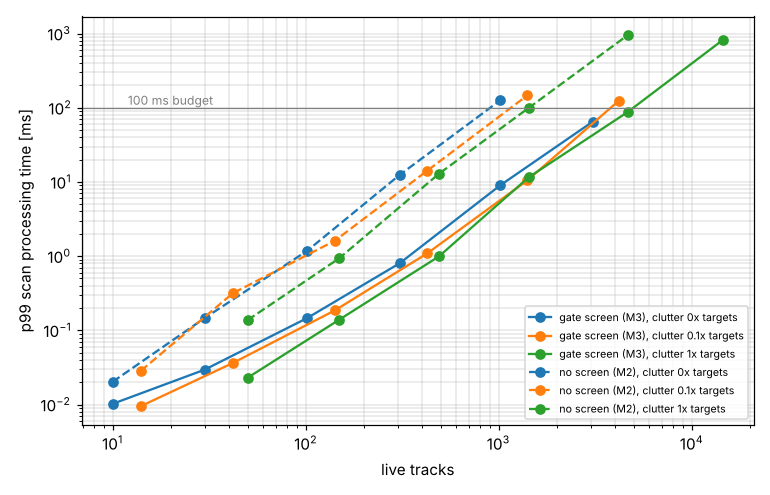

# Benchmarks

> Measured on the 2 vCPU virtual machine described below, with the constant-velocity filter
> that was then the only estimator. Every number below was produced by the
> commands in "Reproduce" and is in the CSV files next to this report; nothing
> is extrapolated. Absolute numbers are machine-specific. The cost of the IMM
> (ADR 0014), now the default estimator, was measured later on a different
> machine, against the legacy filter on that same machine:
> [Motion models](#motion-models-legacy-cv-against-the-imm-adr-0014).

## Machine and build

| | |
|---|---|
| CPU | Intel Xeon (virtualised, model not exposed), 2 vCPUs, 1 thread per core |
| Memory | 8 GB |
| OS | Ubuntu 24.04 userland, Linux 6.18 (virtual machine) |
| Compiler | GCC 13.3.0, `release` preset (`-O3 -DNDEBUG -ffp-contract=off`), Eigen 3.4.0 |
| Load | other work was running on the second vCPU during part of the runs (the "before" column in particular); the run-to-run spread is reported |

## Method (ADR 0011)

- `benchmarks/bench_engine.cpp`: seeded synthetic workload (one radar at the
  origin, N straight-flying targets in a 50 km disc, p_detect 0.95, 10 m /
  0.2° noise, C uniform clutter points per scan, one scan per second of
  scenario time). 10 warm-up scans so tracks are confirmed, then 60 timed
  scans (30 at 3 000 targets). The timer (`steady_clock`) wraps
  `Engine::on_scan` only.
- Each configuration is run 5 times with the same seed. Reported: the median
  over runs of the per-run median, p95, p99 and max scan time, and the spread
  (min-max) of the per-run medians. With 60 scans per run, "p99" is close to
  the run's maximum; treat it as a tail indicator, not a precise quantile.
- "live tracks" is the mean number of live tracks during the timed scans,
  including tentative tracks started by clutter.
- "before (no screen)": the same workload with the M3 gate screen disabled
  (`--no-screen`), i.e. the M2 gating path; 3 runs, up to 1 000 targets.
  Results (tracks, outcomes) are identical with and without the screen;
  only time differs.

## Results

### Per-scan engine latency

| targets | clutter/scan | live tracks | scan size | median ms (spread) | p95 ms | p99 ms | max ms | µs/measurement | before (no screen) median ms |
|---:|---:|---:|---:|---:|---:|---:|---:|---:|---:|
| 10 | 0 | 10 | 9 | 0.008 (0.007-0.008) | 0.008 | 0.010 | 0.016 | 0.81 | 0.016 |
| 10 | 1 | 14 | 10 | 0.009 (0.008-0.010) | 0.009 | 0.009 | 0.011 | 0.81 | 0.021 |
| 10 | 10 | 50 | 19 | 0.021 (0.021-0.021) | 0.022 | 0.023 | 0.024 | 1.08 | 0.096 |
| 30 | 0 | 30 | 28 | 0.024 (0.024-0.025) | 0.027 | 0.029 | 0.047 | 0.88 | 0.104 |
| 30 | 3 | 42 | 31 | 0.029 (0.029-0.030) | 0.034 | 0.036 | 0.054 | 0.96 | 0.147 |
| 30 | 30 | 149 | 58 | 0.114 (0.114-0.117) | 0.126 | 0.139 | 0.141 | 1.98 | 0.806 |
| 100 | 0 | 102 | 95 | 0.126 (0.126-0.126) | 0.135 | 0.147 | 0.160 | 1.34 | 1.072 |
| 100 | 10 | 142 | 105 | 0.158 (0.158-0.158) | 0.179 | 0.186 | 0.190 | 1.52 | 1.503 |
| 100 | 100 | 490 | 195 | 0.936 (0.931-0.955) | 0.978 | 0.991 | 1.010 | 4.82 | 8.615 |
| 300 | 0 | 307 | 284 | 0.759 (0.756-0.760) | 0.793 | 0.802 | 0.809 | 2.67 | 9.408 |
| 300 | 30 | 426 | 314 | 1.013 (1.012-1.018) | 1.062 | 1.087 | 1.249 | 3.25 | 13.281 |
| 300 | 300 | 1429 | 585 | 7.223 (7.115-7.465) | 10.882 | 11.544 | 11.818 | 13.36 | 75.930 |
| 1000 | 0 | 1019 | 949 | 7.255 (7.187-7.363) | 7.715 | 9.019 | 9.759 | 7.76 | 103.397 |
| 1000 | 100 | 1408 | 1047 | 9.986 (9.885-10.091) | 10.455 | 10.513 | 11.067 | 9.55 | 144.931 |
| 1000 | 1000 | 4664 | 1950 | 69.660 (68.731-72.185) | 74.449 | 87.909 | 93.048 | 36.45 | 858.229 |
| 3000 | 0 | 3066 | 2850 | 61.467 (61.146-62.094) | 63.075 | 64.906 | 64.906 | 21.59 | - |
| 3000 | 300 | 4194 | 3150 | 85.278 (84.969-86.869) | 110.738 | 124.795 | 124.795 | 28.60 | - |
| 3000 | 3000 | 14505 | 5849 | 656.102 (634.343-660.642) | 726.859 | 822.813 | 822.813 | 112.88 | - |

### Throughput

309369 measurements/s (3.23 µs each), 300 targets + 30 clutter/scan, 424 live tracks.

### Tracks per core

| targets | clutter/scan | live tracks | p99 scan ms |
|---:|---:|---:|---:|
| 10 | 1 | 14 | 0.01 |
| 10005 | 1000 | 14137 | 1217.95 |
| 5007 | 500 | 6971 | 291.97 |
| 2508 | 250 | 3504 | 91.79 |
| 3757 | 375 | 5237 | 181.20 |
| 3132 | 313 | 4374 | 114.89 |
| 2820 | 282 | 3939 | 94.48 |
| 2976 | 297 | 4155 | 91.97 |
| 3054 | 305 | 4263 | 134.20 |

**Result:** 2976 targets per engine thread (p99 ≤ 100.0 ms).




`docs/benchmarks/scan_latency.png` is generated by `benchmarks/report.py`
from the CSVs (needs matplotlib; the tables do not).

### Reading the numbers

- **Scaling.** Scan time grows roughly with measurements x live tracks:
  association gates every measurement of a scan against every live track. The
  gate screen made each pair ~10-15x cheaper (1 000 targets, 10% clutter:
  median 145 ms -> 10.0 ms) but did not change the shape. Clutter costs twice:
  more measurements per scan, and the tentative tracks they start.
- **Tracks per core.** Budget: one scan of every target per second (1 Hz),
  p99 scan processing ≤ 100 ms (10% of the period, leaving the rest of the
  second for other sensors, publication and headroom), 10% clutter.
  Bisection to ~5% resolution: **2 976 targets** (~4 150 live tracks
  including tentative ones) per engine thread. Near the edge the p99 is
  noisy: in the scan sweep, 3 000 targets + 300 clutter measured p99 125 ms
  while the capacity probe at 2 976 measured 92 ms; quote the result as
  "about 3 000".
- **Throughput.** One engine thread sustains about 309 000 measurements/s on
  back-to-back scans of a 300-target picture, far above what the default
  per-source rate limit (20 000 datagrams/s) admits from one sender.

## Profiling and the one optimisation

Profiled with callgrind on a RelWithDebInfo build (`sifted_bench profile`,
1 000 targets + 100 clutter, 3 scans):

- **Before:** `atan2` 12%, `range_bearing_innovation` 8.5%, `H P H'` 7.4% +
  4.3%, `mahalanobis2` 4.5% + 2.4%, Cholesky 4.3% + 3.4% + 2.4%, `linearize`
  4.2% + 2.5%, `predict_range_bearing` 3.9%, Jacobian 2.7% ... -- together
  over 70%: the per-pair gating computation, done for every measurement-track
  pair although almost all pairs are kilometres apart.
- **Change:** the exact gate screen (`estimation::may_gate`; proof in
  docs/design.md section 10, ADR 0004). General (any range-bearing or
  position sensor, any geometry), no parameters, and bit-for-bit neutral:
  every regression, degraded-network, fault and replay test was re-run
  unchanged, `GateScreen.*` compares full decision traces with the screen on
  and off, and `fuzz_engine` checks the same on arbitrary input.
- **After:** total instructions for the same profile run 8.55 G -> 1.14 G.
  The screen itself (`may_gate`, ~40%) and `process_group` bookkeeping
  (~35%) now dominate. The next step would be a spatial index so that not
  every pair is screened; deferred (design.md section 11).

## Motion models: legacy CV against the IMM (ADR 0014)

Both estimators measured back to back on one machine with the method above
(5 runs per configuration, same seeded workload). Raw output:
[`motion_model_cv.csv`](benchmarks/motion_model_cv.csv),
[`motion_model_imm.csv`](benchmarks/motion_model_imm.csv). Machine: Intel Core
Ultra 7 155H laptop, 22 logical CPUs, 7.8 GB visible to WSL2 (Ubuntu 24.04,
kernel 6.18), GCC 13.3, `release` preset, sources on the Windows file system.
Not the virtual machine above, so compare the two columns with each other, not with the
tables above. A laptop's clock and background load make the tails noisy.

| targets | clutter/scan | live tracks cv / imm | median ms cv | median ms imm | imm / cv | p99 ms cv | p99 ms imm |
|---:|---:|---:|---:|---:|---:|---:|---:|
| 10 | 1 | 14 / 14 | 0.008 | 0.022 | 2.66 | 0.011 | 0.026 |
| 100 | 10 | 142 / 142 | 0.147 | 0.303 | 2.06 | 0.185 | 0.504 |
| 300 | 30 | 426 / 425 | 0.935 | 1.480 | 1.58 | 1.378 | 1.590 |
| 300 | 300 | 1429 / 1459 | 6.507 | 10.255 | 1.58 | 8.132 | 15.346 |
| 1000 | 0 | 1019 / 1019 | 6.615 | 7.958 | 1.20 | 8.089 | 10.043 |
| 1000 | 100 | 1408 / 1409 | 9.097 | 11.542 | 1.27 | 10.787 | 13.388 |
| 1000 | 1000 | 4664 / 4836 | 86.537 | 91.134 | 1.05 | 96.971 | 103.523 |
| 3000 | 0 | 3066 / 3062 | 58.019 | 62.490 | 1.08 | 62.533 | 65.476 |
| 3000 | 300 | 4194 / 4205 | 80.036 | 92.939 | 1.16 | 109.893 | 98.413 |
| 3000 | 3000 | 14505 / 13351 | 759.303 | 816.487 | 1.08 | 812.340 | 864.592 |

| | legacy cv | imm | imm / cv |
|---|---:|---:|---:|
| throughput, 300 targets + 30 clutter, back to back | 327 271 meas/s | 212 875 meas/s | 0.65 |
| tracks per core, p99 ≤ 100 ms at 1 Hz, 10% clutter | 2 976 | 2 898 | 0.97 |

- **Where the cost is.** The IMM's extra work is per track: three modes to mix,
  predict and update, and three linearisations for each measurement that
  reaches the full gate test. The per-pair gate screen costs the same for both.
  Small pictures, and the throughput workload (300 targets), therefore pay
  1.6-2.7x. At 1 000-3 000 targets the all-pairs screen dominates, and the IMM
  costs 5-27% more per scan.
- **Tracks per core.** The IMM's budget limit is within 3% of the legacy
  filter's. The bisection's p99 is noisy on this machine: three bisections of
  the unchanged legacy filter in one day gave 2 039, 2 664 and 2 976. The
  per-scan medians above are the more robust comparison.
- **The optimisation behind it.** The first IMM measurement on this machine
  gave 1 532 tracks per core against 2 664 for the legacy filter. The profile
  (gprof, 1 000 targets + 100 clutter) showed the gate screen run once per
  mode for every measurement-track pair, plus every track predicted twice per
  group. Two results-neutral changes fixed both:
  - one conservative envelope test per pair covering all modes
    (`estimation::may_gate_envelope`; proof in measurement_model.hpp,
    exercised by `GateScreen.ImmBoundIsConservativeOnRandomPairs`);
  - the lifecycle check's prediction reused for gating.

  Both scorecards and every pinned baseline are unchanged, and
  `GateScreen.NeverChangesResults` and `fuzz_engine` check the screen on and off.

Reproduce, from the repository root:

```bash
cmake --preset release && cmake --build --preset release
for m in cv imm; do
  build/release/benchmarks/sifted_bench scan --motion-model $m > scan_$m.csv
  build/release/benchmarks/sifted_bench throughput --motion-model $m > throughput_$m.csv
  build/release/benchmarks/sifted_bench capacity --motion-model $m > capacity_$m.csv
done
```

## End-to-end latency (daemon)

`benchmarks/e2e_latency.py` runs the real `sifted_fusiond` (release) on
loopback, subscribes to its WebSocket stream and sends one radar scan of N
detections per second (30 scans per row, one run per row). Latency: from
sending the scan's first datagram to the arrival, at the WebSocket client,
of the last snapshot stamped with that scan's time (scans over
`max_scan_size` = 256 are processed and published in chunks). Both ends use
the same monotonic clock.

| targets | reorder window s | scans | median ms | p95 ms | p99 ms | max ms |
|---:|---:|---:|---:|---:|---:|---:|
| 10 | 0.0 | 30 | 100.69 | 100.87 | 101.63 | 101.63 |
| 100 | 0.0 | 30 | 101.34 | 101.78 | 101.97 | 101.97 |
| 1000 | 0.0 | 30 | 115.35 | 121.85 | 122.52 | 122.52 |
| 10 | 0.5 | 30 | 501.31 | 501.51 | 501.52 | 501.52 |
| 100 | 0.5 | 30 | 501.86 | 502.42 | 502.59 | 502.59 |
| 1000 | 0.5 | 30 | 518.51 | 524.44 | 529.69 | 529.69 |

What dominates is structural, not processing:

- **~100 ms scan assembly.** A radar scan with nothing after it is flushed
  by the daemon's 100 ms quiet tick (the engine thread cannot know the scan
  is complete before then). With interleaved sensors, the next sensor's frame
  flushes it sooner.
- **+0.4 s with the default 0.5 s reorder window** (ADR 0009): frames are
  held for the window and released by the next tick after it expires, so the
  tick and the hold overlap. This is the price of not losing jittered data;
  `--reorder-window 0` removes it where the network is known to be clean.
- **Processing** adds ~1 ms at 100 targets and ~15-20 ms at 1 000 targets
  (four 256-detection chunks, each associated, formatted as JSON and
  published).

### Cost of crash-durable recording

The daemon with and without `--record` (ADR 0012: records handed to the OS every
64 records or 100 ms, `fdatasync` on its own thread every second). One run of 30
scans per row, on a WSL2 development machine, so compare the columns with each
other and not with the table above. The difference is within run-to-run noise.

| targets | reorder window s | median ms, not recording | median ms, recording |
|---:|---:|---:|---:|
| 100 | 0.0 | 101.98 | 101.69 |
| 1000 | 0.0 | 119.00 | 117.33 |
| 100 | 0.5 | 502.03 | 501.94 |
| 1000 | 0.5 | 533.58 | 532.97 |

Reproduce with `python3 benchmarks/e2e_latency.py <daemon> --targets 100,1000 --record`.

## Reproduce

```bash
cmake --preset release && cmake --build --preset release
build/release/benchmarks/sifted_bench all --runs 5 > docs/benchmarks/engine.csv
build/release/benchmarks/sifted_bench scan --runs 3 --no-screen --max-targets 1000 \
    > docs/benchmarks/engine_no_screen.csv
python3 benchmarks/e2e_latency.py build/release/src/apps/sifted_fusiond > docs/benchmarks/e2e.csv
python3 benchmarks/report.py docs/benchmarks
# profile: a RelWithDebInfo build, then
valgrind --tool=callgrind build/prof/benchmarks/sifted_bench profile --scans 3
```

`sifted_bench all` takes ~15 minutes on this machine (most of it in the
3 000-target and capacity configurations).
