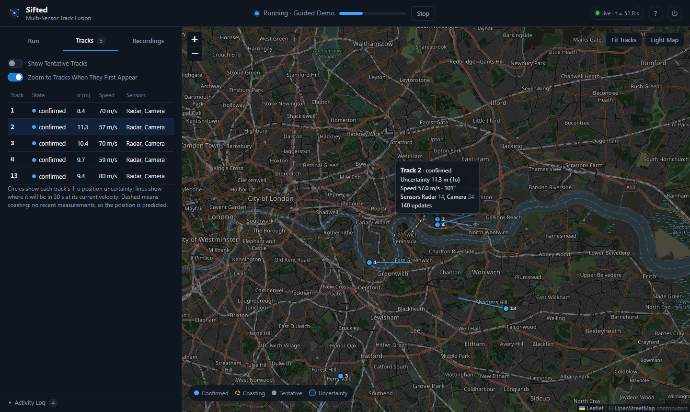
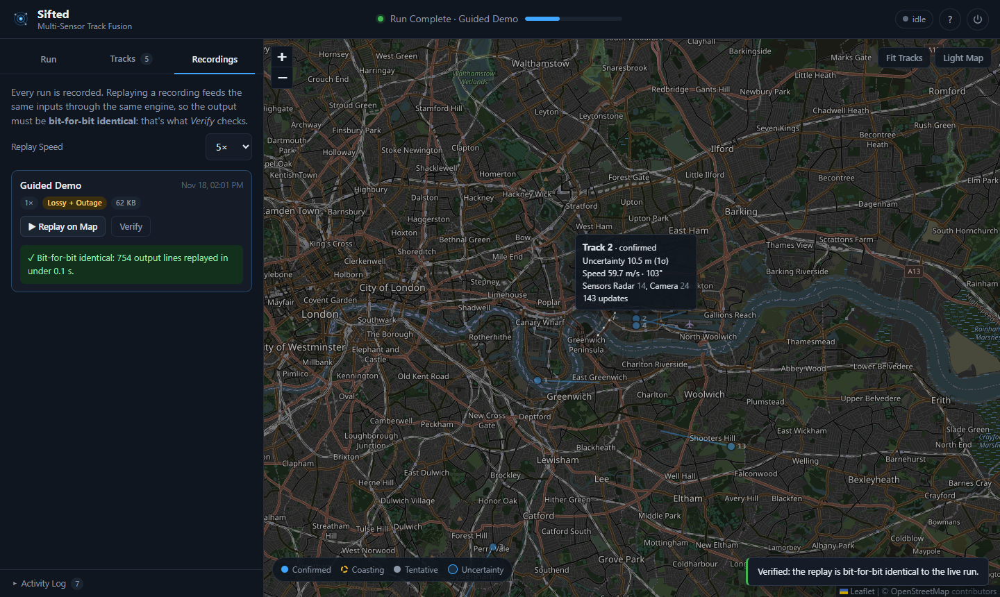

# Installing and using Sifted

The short version is in the [README's quick start](../README.md#quick-start).
This page has the per-platform steps, what the installer changes on your
machine, how to use the app, system requirements and troubleshooting. To build
from source with the CMake presets, see the [development guide](development.md).

## Install

You need about 1 GB of free disk space and an internet connection for the
first install. The installer checks what's already there, installs only what
is missing (it asks first), builds Sifted, tests it end to end and adds a
shortcut. It's safe to run again at any time.

First, get the code: **Code → Download ZIP** on GitHub (then unzip it), or

```bash
git clone <this repository's URL> sifted
```

### Windows 10 / 11

1. Open the `sifted` folder and **double-click `install.cmd`**.
2. If Windows Subsystem for Linux (WSL) isn't set up yet, the installer offers
   to install it. That needs administrator rights and a **restart**; after the
   restart, open **Ubuntu** from the Start menu once to choose a Linux user name
   and password, then double-click `install.cmd` again.
3. When it finishes, Sifted opens by itself and the installer window closes.
   Next time, start **Sifted** from your desktop or Start menu.

Sifted's fusion service is Linux software, so on Windows it runs inside WSL;
the installer and the shortcut handle that for you.

### macOS

1. Install [Homebrew](https://brew.sh) if you don't have it (one command from
   their home page).
2. Open **Terminal**, go to the `sifted` folder, and run:
   ```bash
   ./install.sh
   ```
3. Start Sifted by double-clicking **Sifted.command** on your Desktop, or with `./sifted`.

### Linux

```bash
cd sifted
./install.sh
./sifted
```

Supports apt (Debian, Ubuntu, Mint), dnf (Fedora, RHEL), pacman (Arch) and
zypper (openSUSE). The installer also adds Sifted to your applications menu.

### What the installer sets up

| Component | Why | Installed from |
|---|---|---|
| C++ compiler (GCC 11+ or recent Clang) | builds the fusion service | your package manager (Homebrew `gcc` on macOS if Apple's compiler is too old) |
| CMake 3.21+ and Ninja | build tools | package manager, or a private copy in `build/tools` if yours is too old |
| Eigen 3 | linear algebra (header-only) | package manager, or downloaded during the build |
| Python 3.10+ | simulators and the app launcher (standard library only) | package manager |
| WSL with Ubuntu (Windows only) | runs the fusion service | Microsoft |

Nothing is installed outside your package manager and the project folder.
Recordings are kept in `~/.local/share/sifted` (Linux and Windows/WSL) or
`~/Library/Application Support/Sifted` (macOS).

Installer options: `./install.sh --help` (for example `--yes` to skip
questions, `--with-tests` to also run the full test suites). On Windows, pass
the same as `install.cmd -Yes -WithTests`.

## Using Sifted

Start Sifted from its shortcut. It opens in its own window, with no browser
tabs or address bar, and closing that window stops Sifted. You can also press
**Quit**, the power button at the top right. On Windows the window is native,
built on WebView2 (the Edge engine that ships with Windows), so it has its own
taskbar icon. On macOS and Linux it's a Chrome or Edge "app window", or a normal
browser tab if neither is installed.

From a terminal, `./sifted` (Windows: `sifted.cmd`) starts Sifted with its
messages visible; it then runs until you press Ctrl+C or Quit. The operator
view is served at <http://127.0.0.1:8000/> if you want to open it in a browser
yourself.

1. **Run the guided demo.** It's offered when you first open Sifted. Five
   aircraft fly past one radar and one camera; the side panel tells you what to
   watch for as it happens.
2. **Read the map.** Each dot is a track and the number next to it is its id.
   The circle around it is its uncertainty (1σ) and the line shows where it will
   be in 30 s. Blue tracks are confirmed; amber, dashed ones are *coasting*: no
   recent measurements, so the position is predicted. Hover or click a track for
   details, or open the **Tracks** tab for the full list.
3. **Change the conditions.** Choose another scenario, a playback speed, a
   network condition (perfect, lossy, lossy with an outage) and a sensor fault,
   then press **Run scenario**.
4. **Replay and verify.** When a run ends, press **Replay on map** to watch it
   again from its recording, or **Verify replay** to check that replaying it
   produces exactly the same output. Older runs are in the **Recordings** tab.
5. **Live aircraft (optional).** Open *Live aircraft (ADS-B)* under the run
   options, choose an area (or press *Use map area*) and press *Start live
   feed*. Without an OpenSky account the free quota allows an update only every
   few minutes; with one, set `OPENSKY_CLIENT_ID` and `OPENSKY_CLIENT_SECRET`
   in the environment before starting Sifted for one about every 20 seconds.

<p align="center">
  
  
</p>

Useful launcher options: `./sifted --check` checks the installation,
`--browser` opens a normal browser tab instead of an app window,
`--no-browser` doesn't open anything, `--port N` picks the web port (Sifted
picks the next free port automatically if one is taken), `--run demo` starts a
scenario immediately. `./sifted --help` lists them all.

## System requirements

| | Minimum |
|---|---|
| Windows | Windows 10 version 2004 (build 19041) or Windows 11, with WSL (WSL 2 recommended) |
| macOS | macOS 13 or newer with Homebrew (Apple Silicon or Intel) |
| Linux | any recent distribution with apt, dnf, pacman or zypper (or the tools above installed by hand) |
| Hardware | 2 CPU cores, 2 GB RAM, ~1 GB disk for the build tools and build |
| Browser | a current Chrome, Edge, Firefox or Safari |
| Internet | for the install, map background tiles (OpenStreetMap) and live ADS-B; scenarios, tracking and replay work offline |

**Platform status.** The installer, launcher and operator view have been tested
end to end on Ubuntu 24.04 (GCC 13 and Clang 18). The Windows installer has been
exercised against a simulated WSL, and the macOS path has not yet been run on a
Mac. Reports from either are welcome.

## Troubleshooting

**The installer stopped with an error.** It prints the reason and the last
lines of its log; the full log is `build/install.log`. Fix the cause and run it
again. It picks up where it left off.

**Windows: `install.cmd` closes immediately or says scripts are disabled.**
Run it from a Command Prompt (`cd` to the folder, then `install.cmd`) to see
the message. It runs PowerShell with `-ExecutionPolicy Bypass` for that one
script only.

**Windows: "WSL is not installed" every time.** WSL needs virtualization
enabled in your PC's firmware (BIOS/UEFI) and a restart after it's installed.
Run `wsl --status` in PowerShell to see what's missing.

**Windows: the Sifted shortcut shows an error, or nothing opens.** The message
box says why; the full log is `build\launcher.log`. For every detail, open a
Command Prompt, `cd` to the Sifted folder and run `sifted.cmd`: its window stays
open and shows the error. If the installer's last message
asked you to restart, do that, open **Ubuntu** from the Start menu once, then
run `install.cmd` again: the shortcut only works after that second run.

**Windows: errors mentioning `$'\r'`.** The shell scripts were checked out with
Windows line endings. The installer fixes them; if you run scripts by hand,
re-clone after `git config --global core.autocrlf input`.

**Windows: the browser can't reach `127.0.0.1:8000`.** WSL forwards
`localhost` to Windows by default. If you've turned that off
(`localhostForwarding=false` in `%UserProfile%\.wslconfig`), turn it back on
and run `wsl --shutdown`.

**macOS: "No suitable C++ compiler".** Apple's compiler can be too old for some
C++20 library features Sifted uses. Run `brew install gcc` and `./install.sh`
again; it finds Homebrew's GCC automatically.

**macOS: "Sifted.command can't be opened".** Right-click it, choose **Open**,
then **Open** again. You only need to do this once.

**"Address already in use".** Another program (or another copy of Sifted) is
using a port. Sifted picks free ports at start-up; if a conflict appears later,
quit the other program or restart Sifted. `./sifted --check` shows which ports
are free.

**The map is grey but tracks still show.** Map tiles come from OpenStreetMap
over the internet. Tracking doesn't need them. Check your connection or proxy.

**Live aircraft never appear.** Anonymous OpenSky access allows one update every
few minutes, and the activity log (bottom of the side panel) shows any network
errors. Try a busier area, or use OpenSky API credentials.

**"The fusion service is not built yet".** Run the installer. If you moved the
folder after installing, run it again; it rebuilds quickly.

**Starting over.** Delete the `build` folder and run the installer again.
Recordings live in the data folder listed above; delete it to remove them.
